# Manual de instalación y uso — Picksmart PTL para Odoo 19

[← Volver al manual del alumnado](index.md)

> Este documento está dirigido al profesorado y a las personas responsables de instalar, configurar y mantener el sistema.

## 1. Objetivo

Este proyecto instala en Odoo 19 el módulo **Picksmart PTL Integration** (`om_picksmart_ptl`). El módulo conecta los productos y las operaciones de inventario de Odoo con tags Picksmart V24 mediante un router Picksmart.

La comunicación es bidireccional:

- **Odoo → router → tag:** actualiza el nombre del producto, el stock, la cantidad pendiente, el color y el estado del LED.
- **Tag → router → Odoo:** el router informa a Odoo de la pulsación de un botón mediante un callback HTTP.

## 2. Arquitectura y requisitos

```text
Navegador ───────────────► Odoo 19 :8069 ─────────► PostgreSQL 15
                              │
                              │ HTTP POST /wms/associate/updateScreen
                              ▼
                       Router Picksmart ───────────► Tags PTL
                              │
                              │ HTTP POST /picksmart/callback
                              └────────────────────► Odoo 19 :8069
```

Se necesita:

- Un equipo con Docker Engine y Docker Compose v2.
- Acceso desde el equipo Docker a la IP del router Picksmart.
- Acceso desde el router a la IP del equipo Docker por el puerto TCP `8069`.
- Un router Picksmart y tags asociados a dicho router.
- La MAC de cada tag.

> El router no debe configurarse con `localhost` como destino del callback. `localhost` en el router es el propio router, no el equipo donde se ejecuta Odoo.

## 3. Puesta en marcha con Docker

Todos los comandos de este manual se ejecutan desde el directorio `pick2light`, donde está `docker-compose.yml`.

### 3.1. Arrancar los servicios

```bash
docker compose up -d
```

Comprobar el estado:

```bash
docker compose ps
```

Los dos servicios esperados son:

- `web`: Odoo 19, publicado en el puerto `8069`.
- `mydb`: PostgreSQL 15, con los datos persistidos en `./postgres_data`.

Abrir Odoo en:

```text
http://localhost:8069
```

Desde otro equipo de la misma red se debe usar:

```text
http://IP_DEL_EQUIPO_DOCKER:8069
```

### 3.2. Crear la base de datos de Odoo

En el primer inicio, Odoo mostrará el gestor de bases de datos. Crear una base de datos indicando:

- Nombre de base de datos: por ejemplo, `pick2light`.
- Correo y contraseña del administrador de Odoo.
- Idioma y país adecuados.
- Datos de demostración: opcionales; no son necesarios para producción.

La contraseña maestra del gestor de bases es la definida por la imagen de Odoo si no se proporciona un archivo de configuración propio. Debe cambiarse antes de exponer Odoo fuera de una red controlada.

### 3.3. Instalar el módulo

1. Entrar en Odoo como administrador.
2. Activar el modo desarrollador desde **Ajustes**.
3. Abrir **Aplicaciones**.
4. Ejecutar **Actualizar lista de aplicaciones**.
5. Quitar el filtro predeterminado **Aplicaciones**, si impide encontrar el módulo.
6. Buscar **Picksmart PTL Integration**.
7. Pulsar **Instalar**.

El módulo depende de Inventario (`stock`) y de los traslados por lote (`stock_picking_batch`); Odoo instalará las dependencias necesarias.

## 4. Configuración de la comunicación

### 4.1. Comprobar la red

Obtener la IP del equipo que ejecuta Docker, por ejemplo:

```bash
hostname -I
```

Comprobar desde ese equipo que el router responde:

```bash
ping -c 4 192.168.1.200
```

Si la IP del router es distinta, sustituirla en todos los ejemplos.

También debe comprobarse, desde la red del router, que Odoo responde en:

```text
http://IP_DEL_EQUIPO_DOCKER:8069
```

Si existe un cortafuegos, permitir conexiones entrantes TCP al puerto `8069` desde la IP del router.

### 4.2. Configurar Odoo

En Odoo, ir a **Inventario → Configuración → Ajustes → Picksmart Tags**. Indicar:

- **Picksmart Router IP**: IP del router, sin `http://` y sin ruta; por ejemplo, `192.168.1.200`.
- **Picksmart Style ID**: identificador de la plantilla de pantalla cargada en el router; el valor predeterminado es `50`.

Pulsar **Guardar**.

Odoo enviará las actualizaciones a:

```text
http://IP_DEL_ROUTER/wms/associate/updateScreen
```

### 4.3. Configurar el callback en el router

En la configuración WMS/callback del router Picksmart, establecer:

```text
Método: POST
URL: http://IP_DEL_EQUIPO_DOCKER:8069/picksmart/callback
Content-Type: application/json
```

Ejemplo de cuerpo aceptado:

```json
{
  "mac": "12345678",
  "result": 0
}
```

También se admite `buttonId` en lugar de `result`. La ruta exacta de los menús del router depende de su firmware; consultar el manual del fabricante para localizar el ajuste del callback.

## 5. Asociar un producto a un tag

Cada producto que participe en Pick-to-Light debe tener asociada la MAC de su propio tag. La asociación se realiza desde la ficha del producto:

1. Ir a **Inventario → Productos → Productos**.
2. Buscar el producto y abrir su ficha.
3. Pulsar **Editar**.
4. Abrir la pestaña **Inventario**.
5. Localizar el bloque **Picksmart PTL Integration**.
6. Escribir en **Tag MAC Address** la MAC del tag físico asignado al producto.
7. Dejar **Pickup Quantity** en `0` durante la asociación inicial. El módulo actualizará este valor cuando se envíen recepciones, entregas o lotes.
8. Pulsar **Guardar**.

Al guardar, Odoo intenta enviar inmediatamente al router el nombre del producto, el stock y la cantidad pendiente. Si el tag se actualiza, la MAC y la comunicación con el router son correctas.

La pantalla de productos muestra el stock disponible de cada artículo:

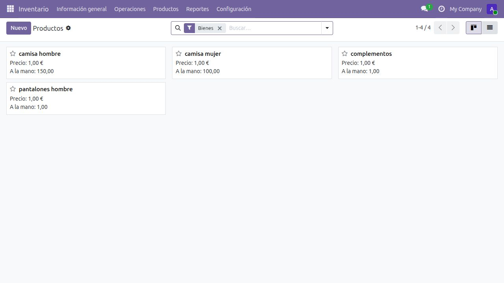

En la ficha del producto, abrir la pestaña **Inventario**. El bloque **Picksmart PTL Integration** contiene la dirección MAC del tag y la cantidad pendiente que se mostrará en el dispositivo:

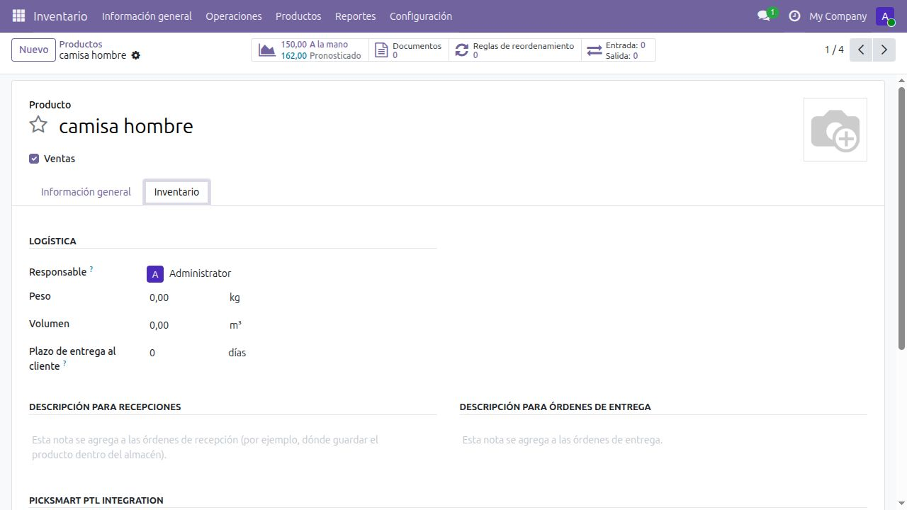

> Los nombres, cantidades y direcciones MAC de los pantallazos son datos de ejemplo de la instalación local. En producción se deben usar la MAC física y las cantidades de cada producto real.

### Reglas para introducir la MAC

- Copiar la dirección exactamente como la identifica el router Picksmart.
- Guardarla **sin el prefijo `CWT`**; por ejemplo, `12345678`.
- Mantener el mismo formato en Odoo y en los callbacks del router.
- No asignar la misma MAC a varios productos: el callback selecciona un único producto.
- No introducir espacios al principio o al final.

El módulo elimina `CWT` al enviar al router y también del callback recibido. Sin embargo, la búsqueda del producto se realiza contra el valor guardado en **Tag MAC Address**; por ello, guardar la MAC sin `CWT` evita que el callback no encuentre el producto.

Para comprobar la asociación, guardar el producto y revisar:

1. Que la pantalla del tag muestre el nombre correcto.
2. Que el stock mostrado coincida con **A la mano** en Odoo.
3. Que en los logs aparezca `HARDWARE TAG -> Comando enviado con éxito`.

Al guardar, Odoo envía al router una trama semejante a esta:

```json
[
  {
    "mac": "12345678",
    "styleid": "50",
    "mappingtype": "791",
    "productName": "Producto de ejemplo",
    "Stock": "25",
    "basketsQuantity": "4",
    "ledstate": "01",
    "ledrgb": "00ff00",
    "outtime": "0",
    "arrow": ""
  }
]
```

`outtime: "0"` mantiene el LED activo hasta que el tag reciba una nueva orden.

## 6. Uso operativo

### 6.1. Significado de la cantidad y del LED

| Situación | `Pickup Quantity` | LED |
|---|---:|---|
| Recepción/entrada pendiente | valor negativo | azul (`0000ff`) |
| Entrega/salida pendiente | valor positivo | verde (`00ff00`) |
| Sin operación pendiente | `0` | apagado (`000000`) |

### 6.2. Albarán individual

1. Crear y confirmar una recepción o entrega en Odoo.
2. Pulsar **Validar** en el albarán.
3. Si el albarán contiene productos con tag, Odoo no completa todavía la operación: envía la cantidad al hardware y muestra el aviso **Operación individual ... enviada al Hardware**.
4. El operario realiza el movimiento físico y pulsa el botón físico configurado para que el router envíe `result = 0`.
5. El router llama al callback de Odoo.
6. Odoo valida el albarán, recalcula el stock, pone la cantidad pendiente a cero y apaga el LED.

En una recepción la cantidad se muestra con signo negativo y LED azul; en una entrega se muestra positiva y con LED verde.

#### Recepciones

Se accede desde **Inventario → Operaciones → Recepciones**. El listado permite identificar la referencia, la fecha, el lote asociado y el estado de cada recepción:

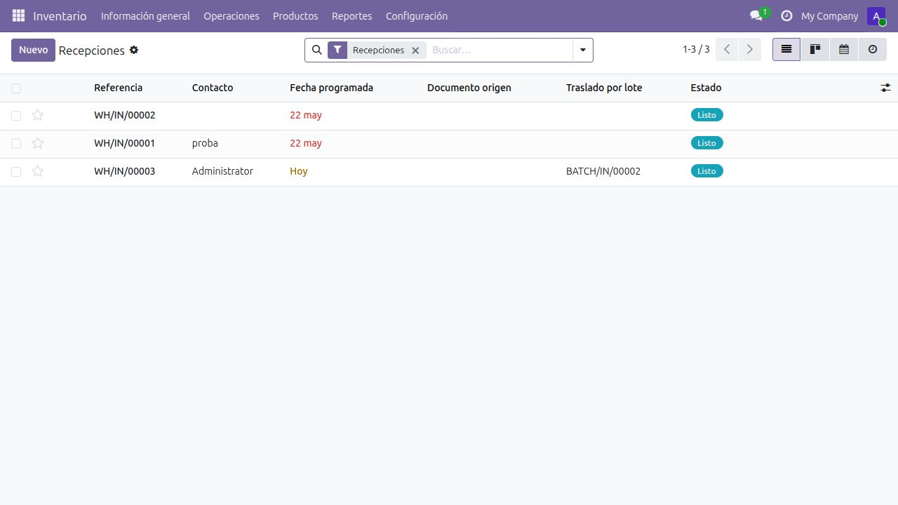

Al abrir una recepción se muestran los productos, la demanda y la cantidad preparada. En el ejemplo, la recepción `WH/IN/00003` está asociada al lote `BATCH/IN/00002` y permanece en estado **Listo**:

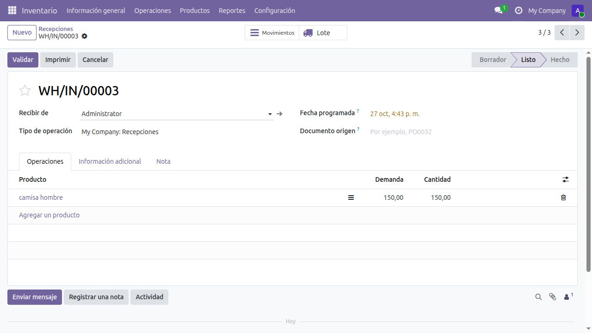

Flujo recomendado:

1. Crear la recepción y añadir los productos.
2. Confirmar que cada producto Picksmart tiene una MAC configurada.
3. Preparar las cantidades recibidas.
4. Pulsar **Validar**. El módulo envía la operación al tag y deja pendiente la confirmación física.
5. Pulsar el botón físico mapeado a `result = 0`. Odoo termina la recepción, actualiza el stock y apaga el LED.

En una recepción, el tag muestra la cantidad pendiente con signo negativo y mantiene el LED **azul** parpadeando. Cuando se haya colocado físicamente toda la mercancía, enviar la confirmación `result = 0`:

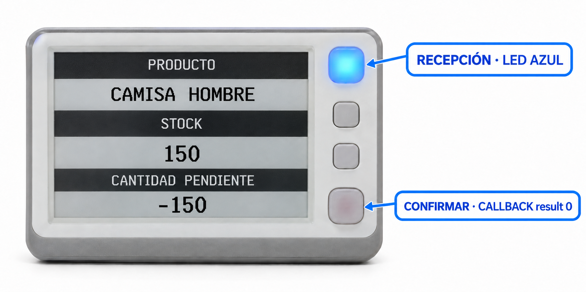

> **Recepción:** azul significa entrada pendiente. El callback `result = 0` confirma el total mostrado; después de procesarlo, Odoo envía `000000` y el LED se apaga. El botón inferior señalado en el mockup es ilustrativo hasta verificar el mapeo del router.

#### Entregas

Se accede desde **Inventario → Operaciones → Entregas**:

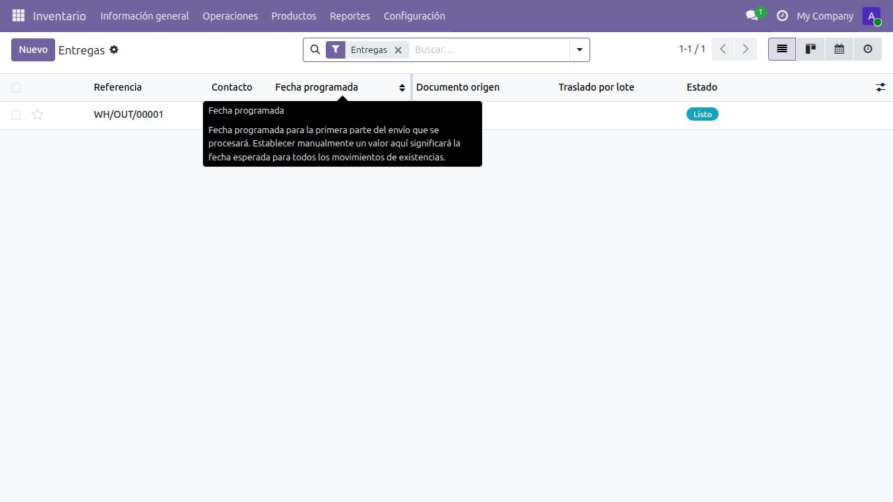

En el detalle deben revisarse el destinatario, la disponibilidad, la demanda y la cantidad antes de enviar la operación al hardware:

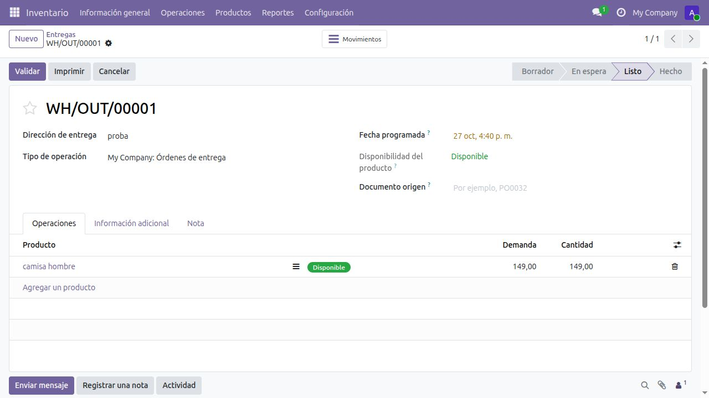

Flujo recomendado:

1. Crear o abrir la entrega.
2. Comprobar que el producto está disponible y que la cantidad preparada es correcta.
3. Pulsar **Validar**. El tag muestra la cantidad de salida y enciende el LED verde.
4. Realizar la recogida física indicada.
5. Pulsar el botón físico mapeado a `result = 0`. Odoo valida la entrega, descuenta el stock y pone la cantidad pendiente a cero.

En una entrega, el tag muestra una cantidad positiva y mantiene el LED **verde** parpadeando. Cuando se haya retirado físicamente toda la cantidad indicada, enviar la confirmación `result = 0`:

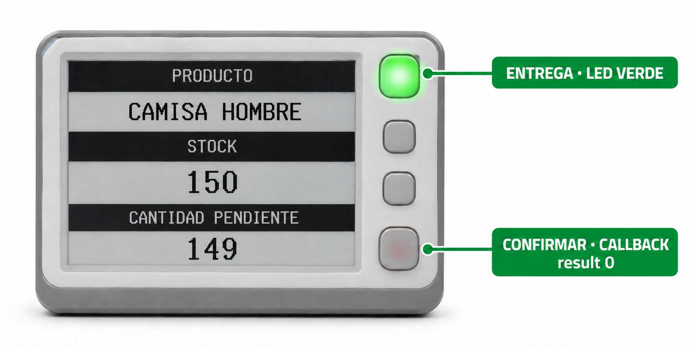

> **Entrega:** verde significa salida pendiente. El callback `result = 0` confirma la recogida; después de procesarlo, Odoo apaga el LED. El botón inferior señalado en el mockup es ilustrativo hasta verificar el mapeo del router.

### 6.3. Traslado por lote u ola con varios productos

1. Agrupar los albaranes en un lote/ola de Odoo.
2. Validar el lote.
3. Odoo separa los movimientos por producto y suma las cantidades del mismo producto.
4. Odoo envía cada total consolidado al tag asociado a ese producto mediante su MAC.
5. Cada tag queda a la espera de su propia confirmación física.
6. Las confirmaciones recibidas permiten procesar los movimientos y validar el lote o sus albaranes asociados.

Se accede desde **Inventario → Operaciones → Traslados por lote**. El listado muestra los lotes en borrador o en progreso:

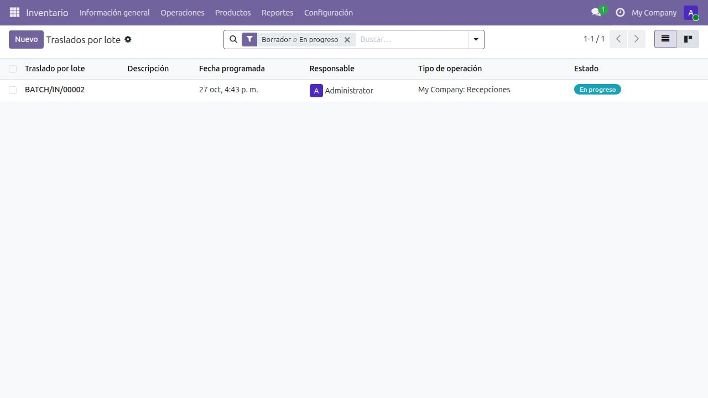

El detalle muestra todos los productos y movimientos de los albaranes incluidos. En el ejemplo, `BATCH/IN/00002` contiene la recepción `WH/IN/00003`:

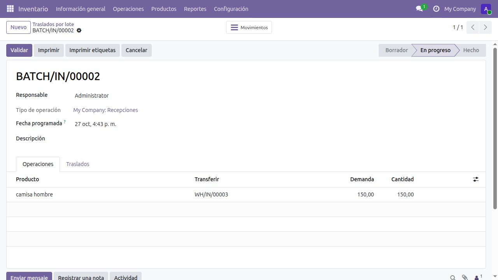

Flujo recomendado:

1. Crear el traslado por lote y seleccionar el tipo de operación.
2. Añadir los albaranes que se procesarán juntos.
3. Iniciar el lote y revisar en la pestaña **Operaciones** todos los productos y cantidades.
4. Confirmar que cada producto dispone de una MAC diferente y de su tag físico.
5. Pulsar **Validar**. El módulo agrupa las cantidades por producto y envía un total distinto a cada tag.
6. Procesar físicamente el total mostrado en cada tag.
7. Confirmar cada tag mediante el control físico que el router tenga mapeado a `result = 0`.
8. Odoo intenta validar el lote contenedor y sus operaciones pendientes.

Ejemplo: si el lote contiene tres albaranes con `10 + 20 + 5` unidades de **Camisa hombre** y otros movimientos de **Camisa mujer**, Odoo envía `35` al tag de Camisa hombre y, por separado, el total de Camisa mujer a su propio tag. No se combinan productos distintos en un mismo tag.

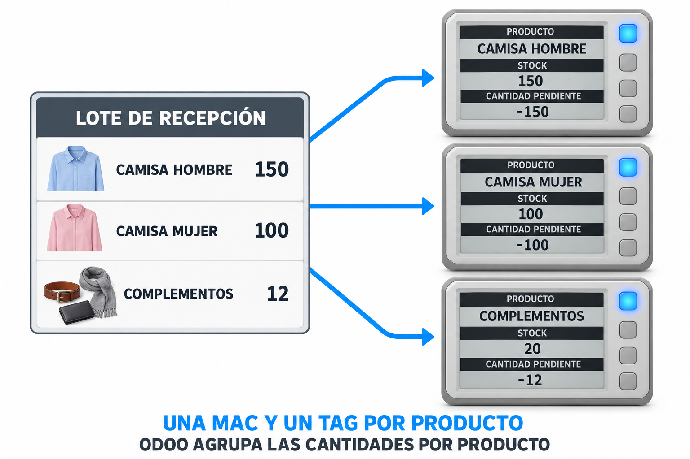

La relación operativa es:

```text
Producto A ── MAC A ── Tag A ── cantidad total del producto A
Producto B ── MAC B ── Tag B ── cantidad total del producto B
Producto C ── MAC C ── Tag C ── cantidad total del producto C
```

No mezclar recepciones y entregas dentro de un mismo lote operativo. El color y el signo de la cantidad se determinan a partir del tipo de operación del lote.

En los traslados por lote se usa el mismo código visual que en los albaranes individuales:

- Lote de recepciones: cantidad consolidada negativa, LED azul y confirmación mediante `result = 0`.
- Lote de entregas: cantidad consolidada positiva, LED verde y confirmación mediante `result = 0`.
- Cada confirmación corresponde a un producto y a la cantidad total consolidada de ese producto, no a una sola línea del lote.

### 6.4. Función de los botones

| Botón recibido | Acción en Odoo |
|---:|---|
| `0` | Confirma la operación pendiente. Valida albaranes/lotes cuando existen, pone `Pickup Quantity` a cero y actualiza el tag. |
| `1` | Incrementa el stock del producto en `1`. |
| `3` | Incrementa el stock del producto en `3`. |

Los botones `1` y `3` realizan ajustes directos sobre la primera ubicación interna encontrada por Odoo. Deben utilizarse solo si ese comportamiento coincide con la operativa del almacén.

El tag físico tiene un LED RGB y tres botones colocados verticalmente. La numeración física indicada por el fabricante y los valores `result` recibidos por Odoo son conceptos diferentes:

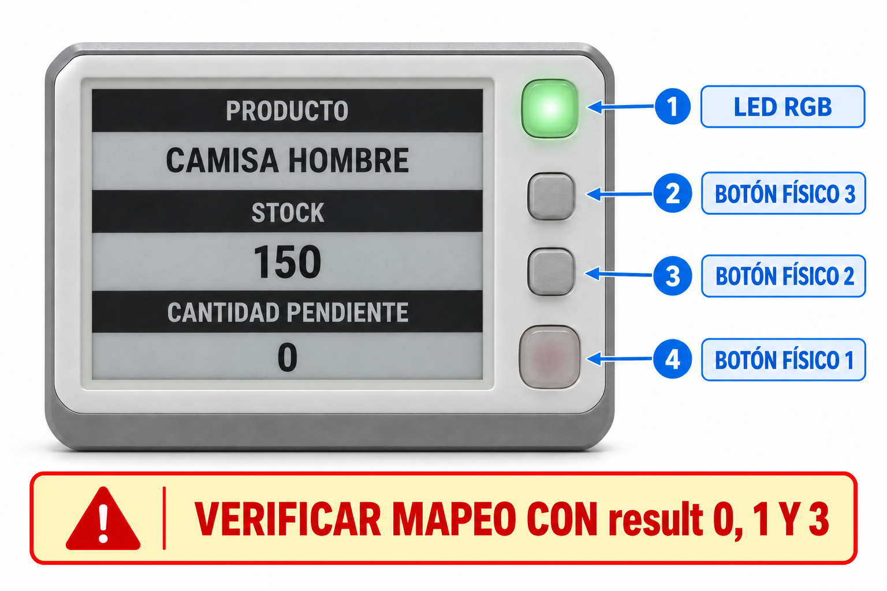

> Antes de operar con stock real, comprobar qué botón físico genera cada valor `result`. El código procesa `result = 0`, `1` y `3`, mientras que la documentación visual del tag denomina los controles `button1`, `button2` y `button3`.

- Botón `1`: suma exactamente una unidad al stock de Odoo.
- Botón `3`: suma exactamente tres unidades al stock de Odoo.
- Tras cualquiera de estas pulsaciones, el módulo actualiza el stock y vuelve a enviar la pantalla del tag con el LED verde.
- Estos callbacks no sustituyen la validación de una recepción o entrega. Para confirmar una operación pendiente Odoo espera siempre `result = 0`.

### 6.5. Ajustes manuales de inventario

Cuando se aplica un ajuste de inventario de Odoo sobre un producto que tiene tag, el módulo vuelve a leer el stock disponible y actualiza la pantalla del tag automáticamente.

## 7. Pruebas

### 7.1. Probar el callback sin pulsar el tag

Antes de ejecutar la prueba, asociar `12345678` a un producto de pruebas. Desde un equipo con acceso a Odoo:

```bash
curl -i \
  -X POST \
  -H 'Content-Type: application/json' \
  -d '{"mac":"12345678","result":1}' \
  http://IP_DEL_EQUIPO_DOCKER:8069/picksmart/callback
```

Respuesta esperada:

```json
{"status": "success"}
```

Esta prueba con `result: 1` incrementa realmente el stock en una unidad. Debe hacerse únicamente con un producto de pruebas.

Si la MAC no existe, la respuesta será:

```json
{"status": "error"}
```

### 7.2. Ver los logs

```bash
docker compose logs -f web
```

Para mostrar las últimas 200 líneas:

```bash
docker compose logs --tail=200 web
```

Los mensajes relevantes contienen textos como `HARDWARE`, `Botón`, `TAG`, `LOTE/OLA` o `CONTROLADOR ROUTER`.

## 8. Mantenimiento

### Reiniciar Odoo

```bash
docker compose restart web
```

### Detener los servicios sin borrar datos

```bash
docker compose down
```

### Volver a arrancar

```bash
docker compose up -d
```

### Actualizar el módulo después de cambiar el código

Sustituir `NOMBRE_BD` por el nombre real de la base:

```bash
docker compose exec web odoo \
  -d NOMBRE_BD \
  -u om_picksmart_ptl \
  --stop-after-init
docker compose restart web
```

### Copia de seguridad

La información de PostgreSQL se conserva en `./postgres_data`. Además de proteger ese directorio, se recomienda usar periódicamente el gestor de bases de datos de Odoo para descargar una copia de la base y del filestore.

No ejecutar `docker compose down -v` ni borrar `postgres_data` salvo que se quiera eliminar la instalación y sus datos.

## 9. Resolución de problemas

### El módulo no aparece en Aplicaciones

- Activar el modo desarrollador.
- Actualizar la lista de aplicaciones.
- Quitar el filtro **Aplicaciones** de la búsqueda.
- Comprobar que `./src` está montado en `/mnt/extra-addons`:

```bash
docker compose exec web ls /mnt/extra-addons/om_picksmart_ptl
```

### Odoo funciona, pero el tag no cambia

- Revisar la IP del router en **Picksmart Tags**.
- Comprobar que Odoo puede alcanzar al router.
- Verificar que la MAC del producto coincide con la del tag.
- Confirmar que el `Style ID` existe en el router y usa los campos esperados.
- Revisar `docker compose logs --tail=200 web`.

El módulo registra el error de comunicación pero no bloquea el guardado en Odoo. Por eso un producto puede guardarse correctamente aunque el router esté apagado o inaccesible.

### El tag se actualiza, pero los botones no modifican Odoo

- Confirmar que el callback usa la IP del equipo Docker, no `localhost`.
- Comprobar que el puerto `8069` está permitido en el cortafuegos.
- Verificar que el router envía `POST` y JSON.
- Probar el callback con `curl`.
- Revisar que `mac` y `result`/`buttonId` llegan con los valores esperados.

### Se recibe `status: error`

Normalmente significa que la MAC no se encontró o que se produjo una excepción. Buscar la MAC en la ficha del producto y revisar los logs de Odoo.

### La cantidad o el stock no son los esperados

- Comprobar si existen varios movimientos pendientes del mismo producto: el botón `0` busca todos los movimientos confirmados, asignados o parcialmente disponibles de ese producto.
- Revisar el tipo de operación: entrada genera valor negativo; salida genera valor positivo.
- Verificar la ubicación interna usada por los ajustes directos de los botones `1` y `3`.
- Probar primero con un único producto, un único albarán y una base de pruebas.

## 10. Seguridad y consideraciones de producción

El endpoint `/picksmart/callback` es público, no usa CSRF y actualmente no valida una clave, firma ni dirección de origen. Cualquier equipo que pueda acceder al puerto `8069` podría intentar enviar pulsaciones y modificar inventario.

Para una instalación real se recomienda:

- Mantener Odoo y el router en una VLAN o red privada controlada.
- Limitar mediante cortafuegos el acceso al callback a la IP del router.
- No publicar directamente el puerto `8069` en Internet.
- Añadir autenticación o firma al callback antes de usarlo en una red no confiable.
- Cambiar credenciales predeterminadas y realizar copias de seguridad.
- Validar la operativa en una base de pruebas antes de usarla con stock real.

## 11. Datos técnicos de referencia

| Elemento | Valor |
|---|---|
| Módulo Odoo | `om_picksmart_ptl` |
| Versión declarada | `1.0` |
| Odoo | `19` |
| PostgreSQL | `15` |
| Puerto Odoo | `8069` |
| Endpoint del router | `POST http://IP_ROUTER/wms/associate/updateScreen` |
| Callback de Odoo | `POST /picksmart/callback` |
| Timeout Odoo → router | 5 segundos |
| Style ID predeterminado | `50` |
| Router IP predeterminada | `192.168.1.200` |
